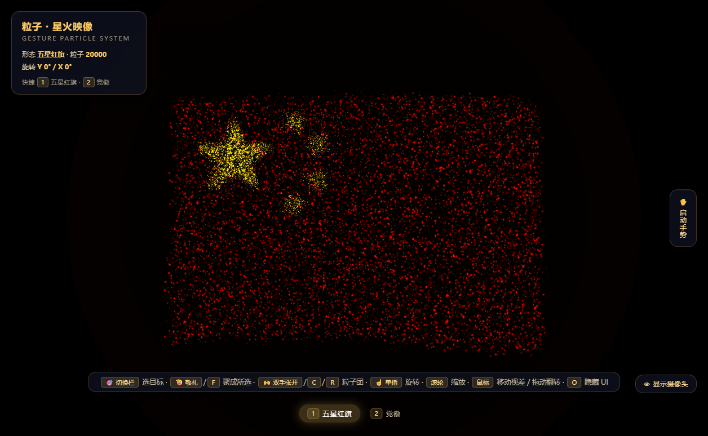

# 粒子・星火映像 · Particle Starfire Vision

用 Three.js 写的一片 20,000 粒子的实时星火：能聚成五星红旗或中国共产党党徽，
可以用摄像头手势指挥，也能用快捷键和鼠标把玩。纯前端、零构建，单个 HTML 文件即可运行。

*五星红旗形态（页面实拍）。*

## 这是什么

一个「形态由粒子实时构成」的交互演示。20,000 个发光粒子在三维空间中漂浮，
通过手势或键盘在三种形态之间平滑形变：

- **粒子团** —— 默认散开态，也是唯一的非实体形态
- **五星红旗** —— 按国标 30×20 网格布点
- **党徽** —— 镰刀锤头轮廓，掩码直接内嵌在代码里

除手势识别需要联网加载 MediaPipe 外，其余全部本地运行：Three.js 与 OrbitControls
已放在 `vendor/`，党徽轮廓不读取任何外部图片，双击 HTML 就能离线打开。

## 亮点

- **20,000 粒子实时形变**：粒子位置向目标形态阻尼吸附，切换过程是连续流动而非跳变；
  其中 6,400 个粒子用于构成五星，描边粒子占比 62%，保证星形轮廓锐利。
- **国旗按国标布点**：旗面 60×40（3:2），大星半径 3 格、四颗小星半径 1 格且各有一角
  正对大星圆心；小星内用拒绝采样填充，星与旗面互不重叠。
- **党徽零外部资源**：120×120 的镰刀锤头轮廓以游程编码（RLE）内嵌，解码后做拒绝采样
  撒点。因此 `file://` 直开、HTTP 打开都能显示，不会出现「本地图片被浏览器拦截」的问题。
- **摄像头手势**：MediaPipe Hands 双手识别 —— 并拢抬手（敬礼）聚成所选形态、双手张开散回
  粒子团、单指移动控制整体旋转。
- **快捷键与鼠标**：`1` / `2` 直接切换项目、`F` 聚形、`C` / `R` 散开；鼠标移动带动整片
  粒子轻微倾斜（阻尼视差跟随），滚轮缩放、拖拽翻转视角。
- **形态排列缓存**：每种形态首次生成后缓存粒子排列，来回切换复用同一份，不会每次重新随机。

## 交互速查

| 操作 | 行为 |
| --- | --- |
| `1` / `2` | 切换项目，并停在该项目对应的粒子团（国旗→红黄 / 党徽→金色） |
| `F` / 敬礼手势 | 聚成当前选中的项目 |
| `C` / `R` / 双手张开 | 散回粒子团 |
| 单指移动 | 控制整片粒子的旋转朝向 |
| 鼠标移动 | 整片粒子轻微视差倾斜（上下 ≈5°、左右 ≈7°） |
| 滚轮 / 左键拖动 / 右键拖动 | 缩放 / 翻转视角 / 平移 |
| `O` | 隐藏 / 显示 UI |
| `R` | 一键复位：视角、旋转、视差、形态回到粒子团 |

底部切换栏的按钮同样可以切换项目，选中项以高亮显示。

## 运行

**方式一，直接双击**

    particles.html

手势识别走 CDN，首次使用「启动手势」时需要联网，并允许浏览器访问摄像头。

**方式二，本地起静态服务**（推荐，避免个别浏览器对本地文件的限制）

    node server.js
    # 然后打开 http://127.0.0.1:8813/   （根路径会自动跳到粒子页）

**方式三，静态托管**

把整个目录作为静态站点发布即可（例如 GitHub Pages）。根目录的 `index.html`
是一行跳转页，因此站点首页与 `…/particles.html` 都能正常进入。

## 文件结构

    .
    ├── index.html         入口跳转页（站点根路径 / Pages 首页自动进入主页面）
    ├── particles.html     粒子交互主页面（全部逻辑都在这一个文件里）
    ├── server.js          本地静态服务器（127.0.0.1:8813，响应带 no-store）
    ├── preview.png        README 预览图（页面实拍）
    ├── README.md
    └── vendor/
        ├── three.min.js           Three.js（本地自带）
        └── OrbitControls.iife.js  轨道控制器（滚轮缩放 / 拖动翻转 / 右键平移）

## 技术要点

- **渲染**：Three.js `Points` + 自定义 ShaderMaterial，逐粒子大小、呼吸漂浮与亮度闪烁；
  加性混合（AdditiveBlending）让星火有辉光感。
- **形变**：每个粒子维护目标坐标，主循环里按阻尼系数逼近，形成「吸附感」；旗帜形态额外
  叠加一层沿自由端增强的飘动位移，党徽形态则降低漂浮幅度让边缘凝实。
- **手势判定**：用「四指是否伸直 + 指尖在垂直于手掌主轴方向上的分散度」区分
  「并拢抬手（敬礼）」与「张开五指（散开）」，并要求手腕抬到画面上 55% 以上才判敬礼。
- **交互锁**：手动切换形态后有 4 秒手势锁，避免摄像头一判定「张开」就把刚聚好的形态打散。
- **视差跟随**：指针位置归一化后在主循环里做阻尼缓动，叠加到整体旋转上，不影响手势旋转
  与相机轨道。

## 已知限制

- 手势识别依赖 `@mediapipe/hands` 的 CDN 资源（版本号已锁定），纯离线环境下只有键盘与
  鼠标交互可用。
- 需要支持 WebGL 的现代浏览器。
- 手势参数针对 320×240、`modelComplexity: 0` 调过；光线不足或手离镜头太远时会不稳定。

## License

尚未指定，可按需要补充（例如 MIT）。